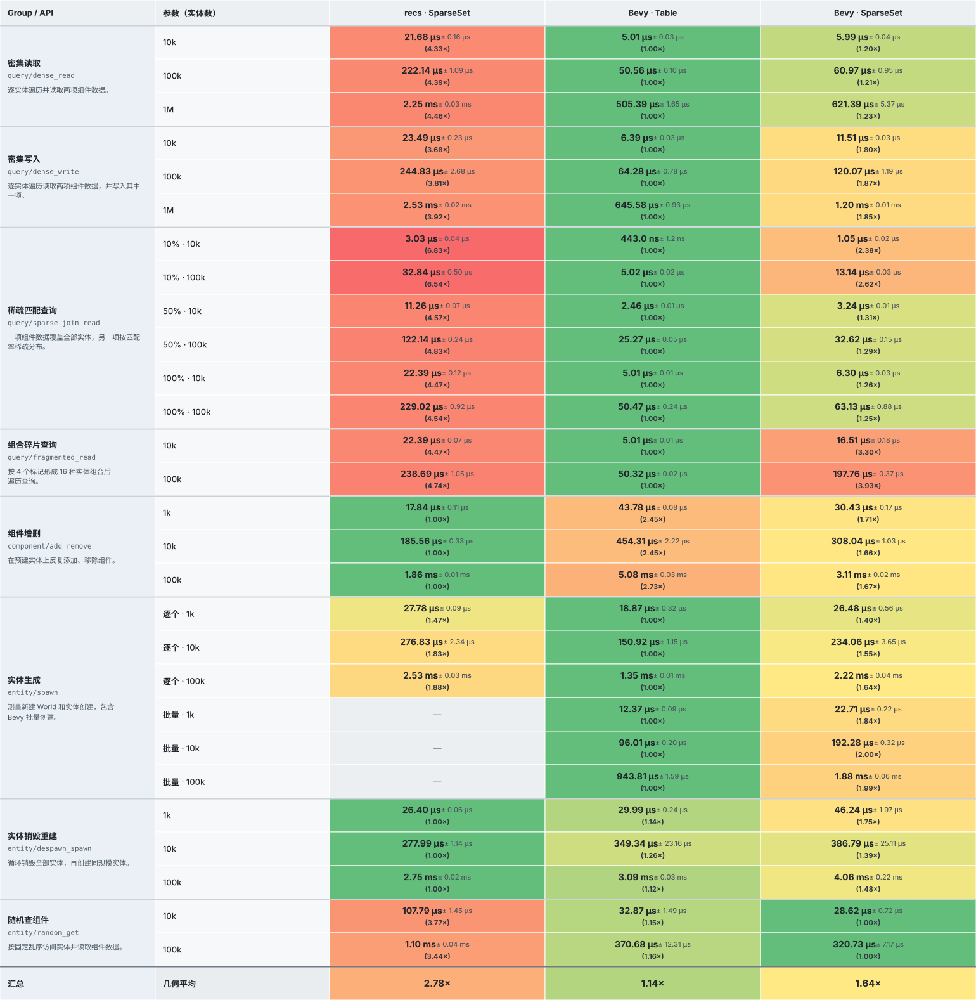

# ECS 基准测试

Benchmark 位于独立 workspace 子 crate `recs-bench`。用 mise 运行：

```sh
mise run bench       # 依次测 recs 和 Bevy，并生成热力图
mise run bench-recs  # 只测 recs，再刷新热力图
mise run bench-bevy  # 只测 Bevy Table 和 SparseSet，再刷新热力图
mise run bench-report # 只用已有数据重生成热力图
```

也可以直接调用 Cargo：

```sh
cargo bench -p recs-bench --bench recs
cargo bench -p recs-bench --bench bevy
```

报告写入 `target/criterion/ecs-heatmap.html`，同目录会有配套 CSS、表格脚本和数据脚本；用浏览器打开 HTML。页面模板和样式在 `benches/report/`，Bun 脚本读取 Criterion 数据并生成表格数据，同时更新 `benches/report/heatmap.svg`。框架名位于吸顶表头；左侧按 Criterion group 合并展示中文说明、原始 key 和简要操作说明，项目列只列变体与实体规模。每行以最快实现归一化为 `1×`，背景颜色由绿到红表示耗时从快到慢。格子显示中位耗时 ± 95% CI 较大偏差，括号内是相对倍数。最后一行是各实现相对每项最快倍数的几何平均。

用例逻辑分别位于子 crate 的 `benches/recs.rs` 和 `benches/bevy.rs`；同目录的 `common/` 只放两边共用的数据类型、规模和 Criterion 配置。

## 覆盖范围

每个 workload 对照 `recs` SparseSet、Bevy 默认 Table、Bevy SparseSet。包括稠密读写查询、10/50/100% 匹配率的 sparse join、16 种组件组合形成的 archetype 碎片、随机组件读取、组件 add/remove、逐个 spawn、despawn/spawn 循环。Bevy 的 `spawn_batch` 单独列项；recs 目前没有批量 spawn API。实体规模按 workload 从 1k 到 1M。

迭代 workload 在计时前建好 World；Bevy QueryState 也在计时前创建并复用，和 [Bevy 自己的 iteration bench](https://github.com/bevyengine/bevy/blob/main/benches/benches/bevy_ecs/iteration/iter_simple.rs) 一样。`recs::World::query` 当前每次调用都会初始化 query，因此该开销计入 recs 的迭代时间。spawn 项计入 World 创建与销毁。

每项采样 20 次，warm-up 500 ms，测量 4 秒。Criterion 原始结果保存在 `target/criterion/`；Bun 脚本读取各项最新的 `new` 结果生成热力图。单框架任务会沿用另一框架最近一次留下的 Criterion 数据；第一次使用时先运行 `mise run bench`，之后可按需单独更新。

## 性能


